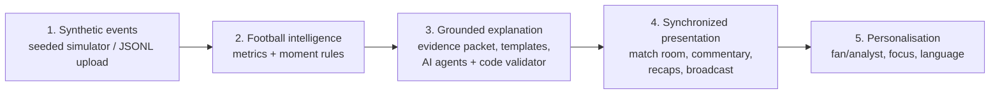
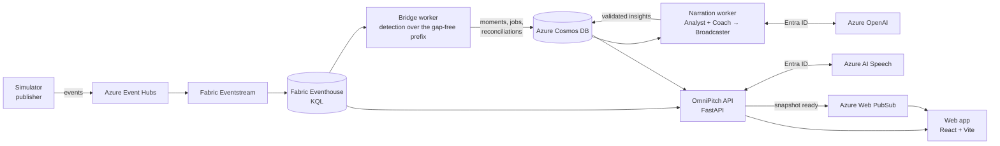
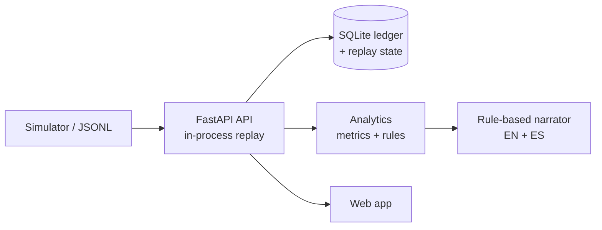
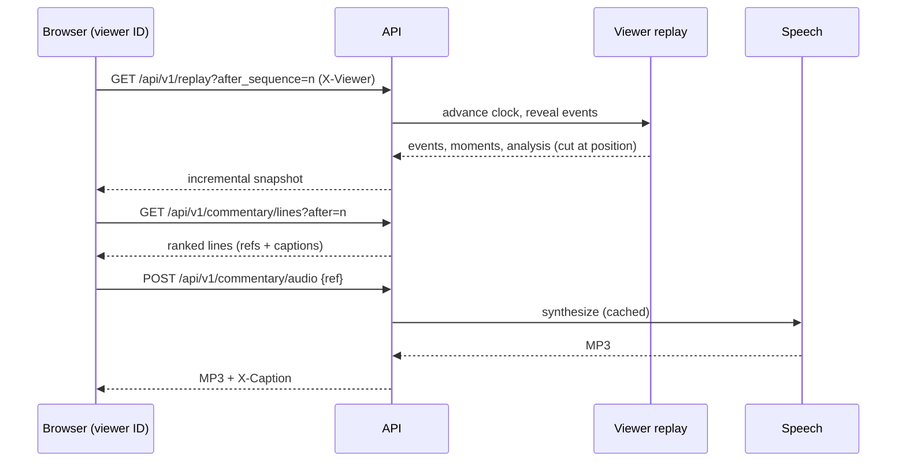
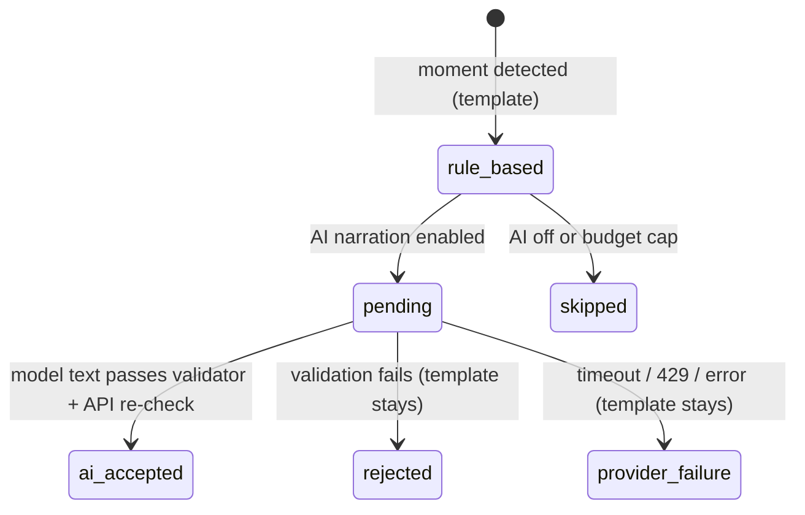
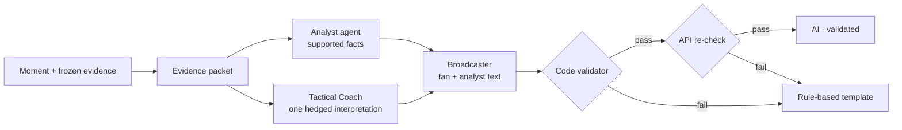

# OmniPitch

**Explainable football match intelligence.** OmniPitch replays a synthetic football match event by event, detects the moments that matter, explains each one in fan or analyst language, narrates the match live, and shows the evidence and calculation behind every claim. All teams, players and events are fictional.

[](LICENSE)

**▶ Try it live: [OmniPitch demo](https://omnipitch-web.politetree-022e7a46.westus.azurecontainerapps.io/)**

- **Live match room:** an animated 2D pitch (with a 3D evidence view), a score and timeline, key moments as they happen, and a match story.
- **Grounded explanations:** every number is calculated in code; AI writes the words, and code checks them against the evidence before anyone sees them.
- **Live spoken commentary:** play-by-play and moment context, read by Azure AI Speech, kept in step with the replay at any speed.
- **Automatic recaps:** half-time and full-time recaps built from that period's events, narrated once, with Listen / Pause / Replay.
- **Personalisation:** Fan or Analyst view, follow a club, player or metric, English or Spanish.
- **Your own replay:** every viewer has their own replay position and can generate a match or upload their own events (JSONL).

---

## Contents

1. [Quick start](#quick-start)
2. [What you can do](#what-you-can-do)
   - [Broadcast view](#broadcast-view)
3. [High-level design](#high-level-design)
4. [Architecture](#architecture)
5. [Low-level design](#low-level-design)
6. [Data contracts](#data-contracts)
7. [Metrics and moment rules](#metrics-and-moment-rules)
8. [AI: grounded explanations](#ai-grounded-explanations)
9. [Commentary and narration](#commentary-and-narration)
10. [API reference](#api-reference)
11. [Repository structure](#repository-structure)
12. [Testing and verification](#testing-and-verification)
13. [Azure mode and deployment](#azure-mode-and-deployment)
14. [Known limitations](#known-limitations)
15. [Licence](#licence)

---

## Quick start

Requirements: Python 3.11+, Node 24+. Verified on Windows; run from the repository root.

```powershell
# Terminal 1: API
python -m venv .venv
.venv/Scripts/python.exe -m pip install -r services/api/requirements-dev.txt
$env:CORS_ORIGINS = "http://localhost:5173"
.venv/Scripts/python.exe -m uvicorn app.main:app --app-dir services/api --host localhost --port 8000
```

```powershell
# Terminal 2: web app
cd apps/web
Copy-Item .env.example .env
npm ci
npm run dev
```

Open [localhost:5173](http://localhost:5173) (API docs at [localhost:8000/docs](http://localhost:8000/docs)). Choose **Fan** or **Analyst**, enter the match room and press **Start the match**. No cloud account is needed: locally, explanations are rule-based and commentary shows captions only.

Optional extras:

- **Narration audio:** set `SPEECH_REGION` and `SPEECH_RESOURCE_ID` in `services/api/.env` (template in `.env.example`), install `services/api/requirements-azure.txt`, and sign in with `az login`. Authentication is Microsoft Entra ID only; no keys.
- **AI explanations and translations:** set the `AZURE_OPENAI_*` values in `services/api/.env`.
- **Broadcast views:** `/producer` and `/overlay` (add `?audience=analyst&lang=es`). See [Broadcast view](#broadcast-view).

**Live demo:** [https://omnipitch-web.politetree-022e7a46.westus.azurecontainerapps.io/](https://omnipitch-web.politetree-022e7a46.westus.azurecontainerapps.io/). Every visitor gets their own replay; the first load after a quiet period can take up to a minute while the app starts.

If Windows reserves port 5173, run `npm run dev -- --port 5212` and add that origin to `CORS_ORIGINS`.

---

## What you can do

| Area | What it does |
| --- | --- |
| **Replay** | Start, pause, seek and change speed (1–80×). Each browser has its own replay; a reload resumes where you left off. |
| **Key moments** | Goals, chances, transitions, threat gains and pressing changes, detected by rules from the recorded events. The newest moment is in the spotlight; the timeline lists the rest in match order. |
| **Evidence** | Every moment opens a drawer with the source action sequence (2D or 3D), the values, the trigger, the calculation, the limitations and how the text was written. |
| **Ask about this moment** | Fixed questions (why it was flagged, how it was calculated, what happened before, what the evidence supports, what is unknown), answered from the evidence. |
| **Commentary** | One switch. Play-by-play and context are spoken automatically; goals interrupt routine lines; at high speed only current, important lines are kept. Subtitles sit under the pitch. |
| **Recaps** | Half-time and full-time, built only from that period: the outcome, the decisive goal, a half-by-half comparison when the balance swung, and the scorers. "Match so far" until the period ends. |
| **Focus** | Follow a club, a player or a metric (pressing, passing, shots). Focus highlights and filters; it never reorders the history or moves the replay. |
| **Analysis** | Team comparison, PPDA pressing chart, player table (with a pass-difficulty indicator and simulated physical data), and a shot map with team and half filters. |
| **Languages** | English and Spanish for the interface, explanations, recaps, commentary and captions. |
| **New match / upload** | Generate a seeded match (four scenarios) or upload your own JSONL events. Only your replay changes. |
| **Broadcast output** | `/overlay` (program output, `?clean=1` for a keyable background) and `/producer` (on air, queue and log), fed by a server-side playout. |

### Broadcast view

A producer view for broadcasters: OmniPitch's key moments aired as on-screen graphics, the way a TV gallery would run them.

1. Open the **Match room** and press **Start the match** (or resume where you left off).
2. Open the **Broadcast view**, either from the link in the landing page's top bar or at `/producer` ([live](https://omnipitch-web.politetree-022e7a46.westus.azurecontainerapps.io/producer)). It opens in a new tab.
3. Keep the match playing. The broadcast view follows **your** replay (same browser), so each key moment airs as a lower-third graphic once the replay reaches it.

What the producer sees:

- **On air:** the current cue (minute, headline, one-line explanation and key numbers) over a pitch graphic of the move.
- **Up next and Log:** the queue and what aired and ended. Goals pre-empt other cues; a cue more than 3 match minutes old is dropped rather than aired late; a rule-based cue is upgraded in place when checked AI text arrives.
- **Switches:** Fan or Analyst wording, English or Spanish, and **Audio commentary** (reads each cue aloud).
- **Outputs:** **Open program output** (`/overlay`, the graphic alone) and **Clean overlay (keyable)** (`/overlay?clean=1`, a transparent background for OBS or a vision mixer).

If the match is paused or not started, the broadcast view waits: nothing airs until the replay reaches a moment. It is read-only; play, pause and seek from the match room.

---

## High-level design

OmniPitch is a five-stage pipeline. Fast, deterministic stages never wait for the slow AI stage; AI improves wording, never facts.



| Stage | Deterministic code | AI (optional) |
| --- | --- | --- |
| Synthetic events | Seeded state-machine simulator; ledger with `(run_id, event_id)` identity and deduplication | none |
| Intelligence | `metrics-v1`, rules `v1`, PPDA windows with sample gates | none |
| Explanation | Evidence packet, rule-based templates (EN/ES), validator, API re-check | Analyst + Tactical Coach → Broadcaster (Azure OpenAI); recap rewrite; Spanish translation |
| Presentation | Snapshot API, commentary composer, recap builder, broadcast playout, speech proxy | Azure AI Speech (audio only) |
| Personalisation | Audience, focus and language in the browser | none |

Design principles:

- **Evidence first.** Every moment has frozen evidence (event IDs, metrics, facts). Explanations, recaps and commentary cite it; nothing ahead of the replay position is ever used.
- **AI never invents numbers.** Model text must reuse the evidence's numbers and names; anything else is rejected and the labelled rule-based text stands.
- **Honest labels.** Each explanation says how it was written: AI-written and checked, rule-based, AI pending, or rejected.
- **Graceful degradation.** Without a model, speech or cloud services, every feature still works with rule-based text and captions.

---

## Architecture

### Cloud pipeline (deployed)



The AI services (Azure OpenAI and Azure AI Speech) are Microsoft Foundry services; the rest of the pipeline is Azure and Microsoft Fabric. All Azure access uses Microsoft Entra ID (managed identity in the deployment); the browser never sees credentials. The API and web app run on Azure Container Apps.

### Local mode (no cloud)



### Request flow in the match room



---

## Low-level design

### Per-viewer replays

- The browser creates a random viewer ID (stored in `localStorage`) and sends it as `X-Viewer` on every API call.
- The API keeps one in-memory `ReplayStore` per viewer (`services/api/app/replay.py`), created from the shared match on first use: same events and run ID (so validated AI text and translations still match), paused at kick-off.
- A replay pauses itself if its viewer stops polling while it plays; the least recently used replays are dropped beyond `OMNIPITCH_MAX_VIEWERS` (default 60).
- Requests without a viewer ID use the shared match, which stays protected on the deployment.

### Replay clock and reveal

- Events are scheduled on a single timeline (`schedule[i]`), with each period starting where the previous one ended.
- `elapsed = elapsed_ms + (now − started_at) × speed`; the revealed prefix is `bisect_right(schedule, elapsed)`.
- Snapshots are incremental (`after_sequence`), validated against the JSON Schemas in the browser, and merged by sequence.
- Analysis and moments are computed only over the revealed, gap-free prefix, so nothing later can leak into a moment, recap or commentary line.

### Ledger and ingestion

- Identity is `(run_id, event_id)`. An identical repeat is a duplicate (ignored); a different payload under the same ID is a conflict (rejected to diagnostics).
- Out-of-order and late events are held until the sequence is gap-free.

### Moment detection

Rules run over the gap-free prefix; each moment gets a stable ID, frozen evidence and a priority:

| Rule | Trigger |
| --- | --- |
| `goal` | A shot recorded as a goal |
| `chance` | A shot on target from 18 m or closer |
| `transition` | A ball win followed within 12 s by ≥ 35 m of forward progress, or by a shot |
| `threat_gain` | The first completed pass in a possession that raises the illustrative threat by ≥ 0.1 |
| `pressing_change` | PPDA falls to ≤ 60% of the previous valid window (at most once every 10 minutes) |

### Explanation lifecycle



### Commentary engine (`apps/web/src/lib/useCommentary.ts`)

- Lines are requested by reference (`event:…`, `moment:…`, `recap:…`); the server composes the text, so the browser never sends text to be spoken.
- **Freshness in match time:** a line is dropped if the replay has moved past it by more than its budget (20 s match time or ~3 s real time; goals 60 s / ~5 s), checked before fetching and again when the audio arrives.
- Goals and whistles interrupt routine lines; at ≥ 5× moment lines are cut to their headline and the voice reads slightly faster.
- Stable line IDs prevent repeats; a seek back or a new run starts a new pass. Recaps follow the whistle once per viewer session.
- One audio hub (`lib/narration.ts`) ranks owners: evidence ("Listen + replay") > recap > live, so two voices never overlap.

### Recap builder (`services/agents/agents/recap.py`)

Built from the period's own events: outcome (including "came from behind"), the decisive goal, a half-by-half shot comparison when the balance swung by ≥ 25 points, and the scorers; plus comparable team stats, a PPDA trend (or an explicit "not enough data"), a player focus and up to three key moments linked to the replay. An optional AI rewrite must pass the same number, name and claim checks.

---

## Data contracts

Versioned JSON Schemas in [`contracts/schemas`](contracts/schemas) (schema 1.1) are shared by the simulator, API and web app, and checked in CI-style scripts (`npm run test:contracts`).

| Schema | Purpose |
| --- | --- |
| `event` | One on-ball action: IDs, period, match time, team, player, type, outcome, start/end in metres, attacking direction |
| `match-state` | Score, clock and replay status |
| `moment` | Rule, priority, frozen evidence IDs, metrics and facts |
| `insight` | Headline and fan/analyst text, generation status, translations, limitations |
| `analysis` | Team and player aggregates, PPDA windows, momentum, pass network |
| `replay` | The incremental snapshot |
| `recap` | Half-time / full-time recap with stats and story |
| `broadcast-cue` | One on-air cue for the overlay |
| `job`, `reconciliation`, `push` | Cloud narration jobs, period reconciliation and push envelopes |

Coordinates are metres on one global 105 × 68 frame; `attacking_direction` records which goal each team attacks, and it swaps at half-time.

---

## Metrics and moment rules

| Measure | Definition |
| --- | --- |
| Pass length | Straight-line distance between the recorded start and end |
| Forward gain | Change in x towards the attacked goal (negative = backwards) |
| Sequence progression | Sum of forward gains in one sequence (transitions) |
| Distance to goal | From the shot's start to the centre of the attacked goal |
| Threat added | Change in an illustrative, hand-designed 16 × 12 grid; **not** a probability |
| PPDA | Opponent passes ÷ defensive actions beyond 42 m, in 5-minute windows; a window needs ≥ 10 passes and ≥ 3 actions |
| Pass difficulty | 0–100 heuristic from length, forward gain, destination and width; not a completion probability |
| Running distance, top speed | **Simulated** from the match events and always labelled "sim."; there is no tracking |

No xG, tracking or off-ball data is calculated or shown.

---

## AI: grounded explanations



The validator rejects: numbers not in the evidence, unknown players, wrong scorelines, lead/level contradictions, box-position and defender-breach claims, probability or causation claims, and evaluative words the data cannot measure. Spanish model translations go through the same checks plus Spanish-specific rules. Each run has a time budget, bounded retries and create-only publication.

---

## Commentary and narration

- **Live commentary:** `GET /api/v1/commentary/lines` and `POST /api/v1/commentary/audio`.
- **Listen + replay:** `POST /api/v1/speech/moment` reads a moment's accepted text while its sequence replays.
- **Recaps:** narrated automatically at the whistle (once), with Listen / Pause / Replay and a transcript in the Recap tab.
- **Speech:** Azure AI Speech REST with Entra ID (`Bearer aad#<resource>#<token>`), MP3 cached by text, language and voice. Voices: `en-GB-RyanNeural`, `es-ES-AlvaroNeural`.
- **Measured pacing (local, real speech):** each line starts within about 4 s (real time) of its action at 1×, 5×, 10×, 20× and 80×.

---

## API reference

| Method and path | Purpose |
| --- | --- |
| `GET /api/v1/replay` | Snapshot (incremental with `run_id` and `after_sequence`) |
| `POST /api/v1/replay/control` | `play`, `pause`, `seek`, `speed`, `reset` |
| `POST /api/v1/replay/generate` | New seeded match (`seed`, `scenario`) |
| `POST /api/v1/replay/load` | Upload JSONL events (≤ 2 MB) |
| `GET /api/v1/replay/recap` | Recap (`scope`, `lang`) |
| `GET /api/v1/replay/physical` | Simulated physical data |
| `GET /api/v1/commentary/lines`, `POST /api/v1/commentary/audio` | Live commentary |
| `GET /api/v1/speech/status`, `POST /api/v1/speech/moment` | Narration |
| `GET /api/v1/broadcast` | Server playout for `/overlay` and `/producer` |
| `GET /api/v1/runs/{id}/events`, `/ledger`, `/moments`, `POST /ingest` | Ledger access and ingestion |
| `GET /health`, `GET /ready` | Liveness and readiness |

Full schema: `http://localhost:8000/docs`.

---

## Repository structure

```text
apps/web/            React 19 + TypeScript + Vite web app (2D/3D pitch, match room, broadcast views)
services/api/        FastAPI API: per-viewer replays, ledger, snapshots, commentary, speech, recaps, broadcast
services/simulator/  Seeded state-machine match simulator, scenarios, simulated physical data, publisher
services/analytics/  Deterministic metrics and moment rules (Python)
services/agents/     Agent prompts, evidence packet, validator, EN/ES templates, recap builder, eval set
services/bridge/     Cloud bridge worker: Eventhouse → moments, narration jobs, reconciliations
analytics/           Illustrative threat grid and KQL
contracts/           JSON Schemas (v1.1) and examples
infra/, deploy/      Azure CLI scripts, Dockerfiles, nginx config
docs/                ARCHITECTURE.md, ROADMAP.md, archive
```

---

## Testing and verification

```powershell
.venv/Scripts/python.exe -m pytest services/api/tests -q    # backend (install services/bridge/requirements.txt too)
cd apps/web
npm run typecheck; npm run build
npm run test:contracts; npm run test:pitch; npm run test:push
npm run test:replay:browser    # headless Chrome end-to-end
```

Latest results (2026-10-27, local):

| Check | Result |
| --- | --- |
| Backend tests | 244 passed, 21 skipped |
| Build, contracts, pitch, push checks | PASS |
| Per-viewer replays (two browsers, upload, landing, subtitles) | 7/7 PASS |
| Stale-state, historical cut-off and full-time recap audio (real speech) | 12/12 PASS |
| Commentary lag at 1×–80× (real speech) | every line within ~4 s |
| Public-copy scan (no implementation text) and Spanish scan | 0 issues |

More detail and dated history: [docs/ROADMAP.md](docs/ROADMAP.md). Technical reference: [docs/ARCHITECTURE.md](docs/ARCHITECTURE.md).

---

## Azure mode and deployment

Microsoft services used. The **AI layer runs on Microsoft Foundry services**: Azure OpenAI (`gpt-4.1-mini`, the three narration roles, recap rewrite and Spanish translation) and Azure AI Speech (narration), both called with Microsoft Entra ID. The data and hosting layers use Azure Event Hubs, Microsoft Fabric, Azure Cosmos DB, Azure Web PubSub and Azure Container Apps, which sit outside Foundry.


| Service | Role |
| --- | --- |
| Azure Event Hubs | Event transport, with duplicate re-delivery tests |
| Microsoft Fabric Eventstream + Eventhouse (KQL) | Durable event store, deduplication, KQL parity checks |
| Azure Cosmos DB | Moments, narration jobs, insights, reconciliations, push outbox |
| Azure OpenAI (`gpt-4.1-mini`) | Three-role narration, recap rewrite, Spanish translation |
| Azure AI Speech | Commentary, recap and moment narration |
| Azure Web PubSub | Push notification that a new snapshot is ready |
| Azure Container Apps + managed identity | API and web hosting without keys |

Set `OMNIPITCH_BACKEND_MODE=azure` and the Eventhouse values in `services/api/.env`; `GET /ready` reports the mode. Setup, permissions, smoke tests and operations are in [ARCHITECTURE.md](docs/ARCHITECTURE.md#azure-mode-phase-2-cloud-path). Infrastructure scripts are in `infra/`.

---

## Known limitations

- **Synthetic, event-only data:** no player tracking, off-ball movement or formations. Physical data is simulated and labelled.
- **No video auto-eventing:** it would need match video and a vision pipeline; this project has neither.
- **AI latency:** moments are detected within seconds, but AI text can arrive minutes later because of model rate limits; until then the labelled rule-based text is shown.
- **Viewer replays live in memory:** an API restart returns viewers to the shared match at kick-off.
- **Threat and pass difficulty are illustrative:** they are not calibrated probabilities.

---

## Licence

OmniPitch is released under the [MIT License](LICENSE).
