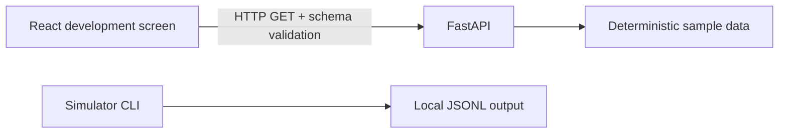

```mermaid
flowchart LR
  S[Simulator] --> EH[Azure Event Hubs]
  EH --> ES[Fabric Eventstream]
  ES --> EHouse[Fabric Eventhouse]
  EHouse --> Bridge[Bridge worker]
  Bridge --> Cosmos[Azure Cosmos DB]
  Cosmos --> Agents[Agent processing]
  Agents --> Validated[Validated insights]
  Validated --> PubSub[Azure Web PubSub]
  PubSub --> UI[Frontend]
```

# Architecture

## Implemented local flow

React fetches `/api/v1/matches/demo/state` and `/api/v1/matches/demo/events` from the configured API. It renders loading, error and success states; refresh repeats the requests. FastAPI validates explicit Pydantic response models and exposes `/health`. Local CORS admits explicitly configured localhost origins with credentials disabled.

The API imports the local simulator module through one repository-relative path in `sample_data.py`; this keeps one deterministic pass algorithm without introducing packaging tooling. It reads the committed match-state fixture. Tests verify that state agrees with the final event and that examples agree with responses. API sample responses are static, with paused replay status.

The simulator CLI accepts seed, run ID, output path, optional count and fixed UTC baseline. It validates each generated event against the shared schema before writing JSONL. `data/generated/` is gitignored. There is no stream or JSONL ingestion endpoint. A later task can explicitly load and validate a selected JSONL replay into the API; do not assume that connection exists now.

JSON Schemas in `contracts/schemas/` are the wire reference. Pydantic and TypeScript are maintained manually. Python and frontend checks validate fixtures; browser responses are validated with the same schemas. AJV is used for boundary validation, not code generation. The insight fixture is not served or generated by an agent.

## Planned cloud flow — not implemented

- Simulator: richer football-realistic synthetic event source and reusable datasets.
- Event Hubs: event ingestion, buffering and partitioning.
- Fabric Eventstream: routing/transformation into Eventhouse.
- Eventhouse: event storage and deterministic live metric queries.
- Bridge worker: planned Azure Functions worker reads incremental data and writes derived match/moment records. Trigger, cursor and recovery strategy still require design.
- Cosmos DB: current match state, moment records, insight records and preference data.
- Agent processing: future Microsoft Agent Framework with a model deployed in Microsoft Foundry; evidence retrieval via Foundry IQ / Azure AI Search. No SDKs, models or accounts connected yet.
- Validated insights: enforce schema, evidence references, deterministic metric attribution, language and limitations before publication.
- Web PubSub: delivery of state and validated insights to clients; reconnect and ordering remain design work.
- Frontend: fan, analyst and broadcast-producer views, with highlights and recaps.

Keep fast deterministic live metrics independent from slower AI explanations. Numerical calculations belong in tested code, not prompts. AI should explain already verified evidence; failed/late explanations must not stop state delivery. Future consumers must tolerate duplicate delivery using run-scoped event identity. Replay ordering, out-of-order handling and idempotence are planned, not implemented.
