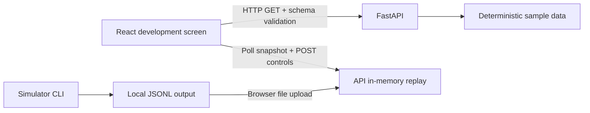

```mermaid
flowchart LR
  S[Simulator] --> EH[Azure Event Hubs]
  EH --> ES[Fabric Eventstream]
  ES --> EHouse[Fabric Eventhouse]
  EHouse --> Bridge[Bridge worker]
  Bridge --> Cosmos[Azure Cosmos DB]
  Cosmos --> Agents[Agent processing]
  Agents --> Validated[Validated insights]
  Validated --> PubSub[Azure Web PubSub]
  PubSub --> UI[Frontend]
```

# Architecture

## Implemented local flow



React polls the atomic `/api/v1/replay` snapshot at 500 ms intervals after each completed request. It renders loading, error, success and disconnected states; refresh/reconnect retrieves current progress rather than creating a run. FastAPI validates explicit Pydantic response models and exposes `/health`. Local CORS admits explicitly configured localhost origins with credentials disabled; GET and POST are allowed.

The frontend renders only revealed replay events. `PassExplorer` follows the newest pass until a user selects one through keyboard-accessible buttons. Selection uses run/event identity and updates both `Pitch` and event details; changing runs clears selection. The responsive SVG uses one viewBox unit per metre in the fixed 105 × 68 frame (x right, y down), with no halftime or attack-direction rotation. Start/end markers, the pass arrow, direction labels and an SVG text description expose the selected path; no player positions are inferred. Empty sequences display an empty pitch and message.

The API imports the local simulator module through one repository-relative path in `sample_data.py`; this keeps one deterministic pass algorithm without introducing packaging tooling. It reads the committed match-state fixture. Tests verify that state agrees with the final event and that examples agree with responses. API sample responses are static, with paused replay status.

The simulator CLI accepts seed, run ID, output path, optional count and fixed UTC baseline. It validates each generated event against the shared schema before writing JSONL. `data/generated/` is gitignored. The browser uploads selected JSONL content to the replay endpoint; the server never opens a client-provided path. There is no cloud event stream.

### Local replay behavior

`ReplayStore` holds one shared replay with a lock, initialized from the five-pass generator. Play/pause uses a server monotonic clock and preserves elapsed intervals; snapshots reveal all due events in sequence. The displayed match clock is the latest revealed event's period-local time, not a continuously interpolated clock. Crossing periods uses the previous period's last event as the offset, without an invented halftime delay. Final arrival changes status to `finished`; use reset to replay again.

Loading validates the complete UTF-8 JSONL before replacement: at most 1 MiB and 1000 events, one source run/match, unique event IDs, contiguous sequences starting at 1, and nondecreasing time within ordered periods. File lines may be out of order; events are sorted by sequence. Only completed passes for match `demo` and teams `harbor`/`vale` are supported, because match metadata still comes from the fixture. Load/reset creates a new run ID, remaps events to it, preserves event IDs/geometry/timestamps and starts paused with zero revealed events. Control/load requests include the expected run ID; stale requests return 409. Invalid uploads preserve the loaded run. Custom errors use `detail: {code, message}`; request-model failures use FastAPI's normal 422 validation response.

An atomic snapshot bundles state, revealed events and total count; the browser validates its schema, ordering, progress and identity. UI mutation requests invalidate earlier poll results. A failed poll preserves the last snapshot and disables controls until reconnect. This local controller has no authentication or persistence and must run with one API worker; multiple viewers share the same controls. Separate host permissions and durable/cloud processing remain future work. No background event publisher is present: elapsed replay progress is materialized when snapshots or controls are requested.

JSON Schemas in `contracts/schemas/` are the wire reference. Pydantic and TypeScript are maintained manually. Python and frontend checks validate fixtures; browser responses are validated with the same schemas. AJV is used for boundary validation, not code generation. The insight fixture is not served or generated by an agent.

## Planned cloud flow — not implemented



- Simulator: richer football-realistic synthetic event source and reusable datasets.
- Event Hubs: event ingestion, buffering and partitioning.
- Fabric Eventstream: routing/transformation into Eventhouse.
- Eventhouse: event storage and deterministic live metric queries.
- Bridge worker: planned Azure Functions worker reads incremental data and writes derived match/moment records. Trigger, cursor and recovery strategy still require design.
- Cosmos DB: current match state, moment records, insight records and preference data.
- Agent processing: future Microsoft Agent Framework with a model deployed in Microsoft Foundry; evidence retrieval via Foundry IQ / Azure AI Search. No SDKs, models or accounts connected yet.
- Validated insights: enforce schema, evidence references, deterministic metric attribution, language and limitations before publication.
- Web PubSub: delivery of state and validated insights to clients; reconnect and ordering remain design work.
- Frontend: fan, analyst and broadcast-producer views, with highlights and recaps.

Keep fast deterministic live metrics independent from slower AI explanations. Numerical calculations belong in tested code, not prompts. AI should explain already verified evidence; failed/late explanations must not stop state delivery. Future consumers must tolerate duplicate delivery using run-scoped event identity. Replay ordering, out-of-order handling and idempotence are planned, not implemented.

## Wire contracts and requirements

## Coordinates and clocks

Pitch is 105 × 68 metres. A single fixed corner is `(0, 0)`; x follows the length and y the width. The frame never rotates at halftime. Bounds are inclusive; attack direction is `positive_x` or `negative_x`. Points describe the pass path, not full player tracking. Missing player/off-ball tracking must not be invented.

`period` currently supports 1 or 2. `match_time_ms` is elapsed milliseconds within that period, including potential stoppage time. `emitted_at` is a UTC wall-clock timestamp ending in Z; fixture baseline is `2026-01-01T12:00:00Z`. Emission time and match time are different concepts even though the fixture increments both by three seconds per event.

A replay reset creates a new `run_id`. Event identity is `(run_id, event_id)`; sequence is ordered within a run/match. Evidence IDs refer to event IDs within the insight's `run_id` and `match_id`, never globally. Later consumers must handle duplicate delivery.

## Current example

Run `demo-run-001`, match `demo`: fictional Harbor Comets versus Vale Owls, 0–0. Seed 7 produces five completed Harbor passes in possession-001; each endpoint becomes the next start. `event.example.json` is the first pass. State is paused at sequence 5, period 1, 15,000 ms. Insight cites all five events and reports `completed_passes: 5 passes`. The API serves state and the full sequence, not the insight.

All fixture records have schema version 1.0 and synthetic data is labeled. Event type is `pass`, outcome is `completed`; these are the only supported values. Future shots, goals, turnovers, carries, tracking and substitutions require contract changes and implementation. They are not supported now.

Insight `generation_mode: fixture` means a hand-authored example, distinct from future AI-generated or fallback output. Only English is supported in this schema version; multilingual extensions are planned. Metrics always have a name, value and unit. No illustrative threat metric is included; any future illustrative threat score must not be described as calibrated expected threat or scoring probability. Pass continuity alone does not establish a tactical pattern.


Schemas: [event](../contracts/schemas/event.schema.json), [match state](../contracts/schemas/match-state.schema.json), [insight](../contracts/schemas/insight.schema.json). Models: [Pydantic](../services/api/app/schemas.py) and [TypeScript](../apps/web/src/types/contracts.ts). Changing a contract requires aligned examples, models, boundary validation, tests and documentation.

The additional [replay snapshot schema](../contracts/schemas/replay.schema.json) references the existing event/state schemas; its [example](../contracts/examples/replay.example.json) represents an initial paused run. Existing event/state/insight contracts and static sample endpoints remain unchanged.

## API and configuration

| Endpoint | Response |
| --- | --- |
| `GET /health` | `{"status": "ok", "application": "omnipitch-api"}` |
| `GET /api/v1/matches/demo/state` | Committed match-state fixture |
| `GET /api/v1/matches/demo/events` | `{"events": [...]}` from the shared five-pass generator |
| `GET /api/v1/replay` | Atomic `{state, events, total_events}` snapshot of the current replay |
| `POST /api/v1/replay/control` | JSON `{run_id, action}`; action is `play`, `pause` or `reset`; returns snapshot |
| `POST /api/v1/replay/load?run_id=...` | UTF-8 JSONL file content (`text/plain`); validates/replaces run and returns snapshot |
| `/docs` | Interactive OpenAPI documentation |

`CORS_ORIGINS` defaults to `http://localhost:5173` and accepts comma-separated explicit localhost origins without paths. Arbitrary origins and credentialed CORS are disabled. The backend does not auto-load `.env`; its `.env.example` documents shell configuration.

Frontend `VITE_API_BASE_URL` defaults to `http://localhost:8000`. Vite uses strict port 5173. AJV validates responses; network, HTTP and contract errors become visible UI messages. `contract-check.ts` checks TypeScript fixture alignment. Ordinary CSS is used without routing or a global state framework.

## Local tools and verification

Install development dependencies and start the applications using [README](../README.md#local-setup). Runtime-only API installation can use `services/api/requirements.txt`; tests and simulator CLI also require development dependencies.

Generate JSONL from repository root (PowerShell):

```powershell
$env:PYTHONPATH = "$PWD/services/simulator"
.venv/Scripts/python.exe -m simulator.generate --seed 7 --run-id demo-run-001 --output data/generated/demo.jsonl
Remove-Item Env:PYTHONPATH
```

Options: `--count` (1–1000, default 5) and `--baseline` (explicit UTC, default `2026-01-01T12:00:00Z`). Identical seed/run/count/baseline produce identical bytes. A different run ID preserves seeded geometry but creates new run-scoped identities. Each invocation replaces its output file; use gitignored `data/generated/` and keep contract examples tracked. The CLI validates events with jsonschema before writing; the API validates its generated responses with Pydantic.

Backend checks from repository root:

```powershell
.venv/Scripts/python.exe -m pytest services/api/tests -q
.venv/Scripts/python.exe -m pip check
```

With API running:

```powershell
Invoke-RestMethod http://localhost:8000/health
Invoke-RestMethod http://localhost:8000/api/v1/matches/demo/state
Invoke-RestMethod http://localhost:8000/api/v1/matches/demo/events
```

Frontend checks:

```powershell
cd apps/web
npm run test:contracts
npm run test:pitch
npm run typecheck
npm run build
```

Optional combined HTTP smoke check from root, with dependencies installed and ports 8000/5173 free:

```powershell
.venv/Scripts/python.exe services/api/tests/smoke_local.py
```

The smoke runner starts temporary API/Vite processes, validates responses/CORS, requests frontend modules/shared schemas, invokes the simulator CLI, writes logs/output under `data/generated/`, and stops the processes. It does not automate browser interaction.

`test:pitch` renders the actual TSX components through React server rendering and checks both attack directions, inclusive coordinate boundaries, the empty state and initial event selection. It uses existing TypeScript/React dependencies without a separate test framework; it does not automate browser clicks or verify visual appearance.

`npm run test:replay:browser` from `apps/web` is an optional headless Chrome integration check using Node's built-in WebSocket client. It starts temporary API/Vite servers, loads out-of-order JSONL through the real file picker, verifies play/pause/resume/finish, pitch selection, page-refresh recovery, invalid upload preservation and reset identity, then stops the processes. Install the existing Python/frontend dependencies and keep ports 8000/5173 free. Chrome defaults to `C:/Program Files/Google/Chrome/Application/chrome.exe`; set `CHROME_PATH` for another installation. Logs, test JSONL, isolated browser profiles and a screenshot are written under gitignored `data/generated/`. No browser-testing dependency is added.

macOS/Linux variants (documented, not verified): from root, `python3 -m venv .venv`, `source .venv/bin/activate`, `python -m pip install -r services/api/requirements-dev.txt`, then `CORS_ORIGINS=http://localhost:5173 python -m uvicorn app.main:app --app-dir services/api --host localhost --port 8000`. In another terminal: `cd apps/web`, `cp .env.example .env`, `npm ci`, `npm run dev`. Simulator: `PYTHONPATH=services/simulator .venv/bin/python -m simulator.generate --seed 7 --run-id demo-run-001 --output data/generated/demo.jsonl`.

## Decisions and dependency baseline

The [archived decision log](archive/DECISIONS.md) preserves original rationale and consequences. Current decisions:

| ID | Decision |
| --- | --- |
| D001 | Use the existing monorepo for shared interfaces/tests; preserve its remote and avoid another nested checkout. Historical workstation paths do not constrain a new checkout. |
| D002 | Local-first foundation without cloud credentials, deployment, databases, authentication or streaming. |
| D003 | React/TypeScript/Vite and ordinary CSS; Python/FastAPI/Pydantic. Pin direct dependencies and retain npm lockfile. |
| D004 | Fixed pitch frame, explicit attack direction, period-local milliseconds, UTC emissions and run-scoped identity. |
| D005 | Fictional teams/players and completed passes only; preserve continuity without implying real tracking or evaluation. |
| D006 | JSON Schema draft 2020-12 wire reference, manually aligned models and boundary validation; no code generation. |
| D007 | Add cloud SDKs only for an authorized integration that requires them. |
| D008 | Share the simulator algorithm through a repository-relative import; demo metadata stays a fixture. JSONL replay ingestion was added on 2026-10-13; independent packaging remains future work. |
| D009 | License remains pending owner decision; no LICENSE file has been selected. |
| D010 | Keep the recorded tested dependency baseline and RFC3339 validation; this is not a claim that packages are latest. |
| D011 | Maintain README, AGENTS, ROADMAP and ARCHITECTURE; archive duplicate guides and history after preserving current requirements. Approved documentation consolidation on 2026-10-11. |
| D012 | Use an atomic snapshot and server-timed, single-process in-memory replay for Phase 1. Validate uploaded content before replacement, reject stale controls and create new run IDs on load/reset. This avoids separate state/events races without introducing persistence or streaming services. Recorded 2026-10-13. |

Recorded October 7 runtimes: Node 24.11.0, npm 11.6.1, Python 3.13.7 and venv pip 25.2. Frontend pins: React/React DOM 19.1.0, TypeScript 5.8.3, Vite 8.3.3, React plugin 6.1.2, React types 19.1.2, AJV 8.20.0 and ajv-formats 3.0.1. Backend pins: FastAPI 0.115.12, Pydantic 2.11.4, Uvicorn 0.34.2. Check dependencies: pytest 8.3.5, httpx 0.28.1, jsonschema 4.23.0 and rfc3339-validator 0.1.4.

Exact frontend resolution is in `apps/web/package-lock.json`; Python direct pins are in requirements files, with transitive dependencies resolved by pip rather than fully locked. Older Vite pins stalled during build and Vite/AJV advisories led to the recorded baseline adjustment. See [historical progress](archive/PROGRESS.md) for actual results.

Local environments, `.env`, dependencies, builds, test output and generated JSONL are ignored. `.env.example`, shared fixtures and Cursor instructions remain tracked. Agents and analytics have no executable workflows yet; no cloud SDKs or connections are present.
