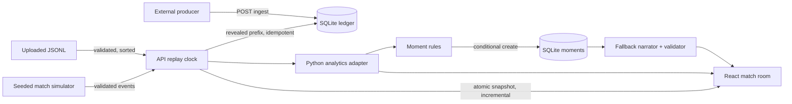
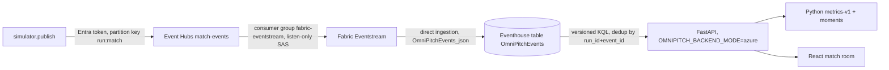

# Architecture

## Implemented local flow



This is the local stand-in for the guide's reference architecture. SQLite plays the role of Eventhouse (event ledger) and Cosmos DB (replay state and moments). The Python analytics adapter is the guide's documented day-two fallback for Fabric/KQL. Detection, the evidence packets and the validator are shaped so that a bridge worker, Cosmos change feed and a Foundry model can replace their local counterparts without changing the contracts.

### Replay and recovery

`ReplayStore` owns one shared run under a lock. On a new process, it restores the last saved run from `replay_state`: same run ID and events, paused at the stored position (status `finished` stays finished). Otherwise it simulates seed 7, `standard`. The replay clock is server-monotonic: `elapsed × speed` maps to match time across both periods, and period 2 starts after period 1's last recorded event, with no invented halftime delay. Speeds are 1, 5, 10, 20, 40 or 80×. A seek reveals exactly the events at or before the target. Speed changes fold elapsed time first, so position is preserved. Reset, load and generate create a new `run_id`. Every control or load request carries the expected run ID; stale requests return 409.

Revealed events are inserted into the ledger once, in sequence order. Analysis and moments are computed from the revealed prefix and cached by `(run_id, latest_sequence)`. Moments are stored with `INSERT OR IGNORE`, so evidence is frozen at detection time. Snapshots serve stored moments filtered by `source_sequence ≤ latest`, so seeking backwards hides later moments.

Snapshots are atomic and incremental. `GET /api/v1/replay?run_id=R&after_sequence=N` returns events after N and moments with `source_sequence > N` when R is current; otherwise it returns everything (`events_offset = 0`). The browser validates every response with AJV against the shared schemas, merges increments, polls every 450 ms (2 s while hidden), and invalidates in-flight polls whenever it sends a control. A failed poll keeps the last state visible and disables controls until reconnection.

### Ingestion ledger

`POST /api/v1/runs/{run_id}/ingest` accepts UTF-8 JSONL (≤ 2 MiB, ≤ 2500 lines) and validates each line independently:

- Identity is `(run_id, event_id)`.
- An identical repeat counts as a duplicate and changes nothing.
- A different payload under an existing identity is rejected as `conflicting_duplicate`, and the first version is kept.
- Invalid lines, wrong-run events and unknown teams go to `diagnostics` with reasons.
- `GET /runs/{id}/metrics` recomputes metrics only over the contiguous `sequence` prefix, so a gap stops windowed metrics instead of silently skipping events.
- `GET /runs/{id}/ledger` reports received, unique, duplicate, rejected and missing-sequence counts.

## Wire contracts (schema version 1.1)

Schemas in `contracts/schemas/`: `event`, `match-state`, `insight`, `moment`, `analysis` and `replay`. Pydantic (`services/api/app/schemas.py`) and TypeScript (`apps/web/src/types/contracts.ts`) are aligned manually. Python tests and `npm run test:contracts` validate the fixtures, and the browser validates responses.

Events cover these types:

- `pass` (completed or incomplete)
- `shot` (goal, saved, off_target or blocked, with consistent `on_target`/`is_goal`)
- `tackle` and `challenge` (won or lost), `interception` (won) and `foul` (committed)
- `period_start` and `period_end`

Period markers carry no team, player, possession or location. Every team action carries team, player, possession, `start` and `attacking_direction`; only passes and shots have `end`. Schema 1.0 files (completed passes only) remain readable. Each `insight` has `generation_mode` set to `fixture`, `ai` or `fallback`, plus optional `knowledge_source_ids`.

### Coordinates and clocks

The pitch is 105 × 68 m with one fixed global frame: x along the length, y across, and no rotation at halftime. Harbor attack +x in period 1, Vale attack +x in period 2. Metrics use a team-relative attacking frame: for `negative_x`, `x' = 105 − x` and `y' = 68 − y`. `match_time_ms` is period-local and includes stoppage; `emitted_at` is UTC wall-clock. Event identity is `(run_id, event_id)`. Player tracking is never inferred.

## Simulator

`services/simulator/simulator/match.py` is a state machine. It tracks period, clock, score, ball location (team-relative), possession and carrier, and chooses the next action from that state:

- **Pass**: completion probability falls with distance, final-third depth and pressure. An incomplete pass turns over possession.
- **Defensive action**: opponent tackle, interception (recorded after the cut-out pass), challenge or foul. Pressure raises this in the opponent's build-up zone.
- **Shot**: probability rises inside the final third. Goals restart from the centre and increment the score; other outcomes give the defending team a goal kick.
- **Counterattack**: a turnover in an advanced area can trigger rapid forward passes.

Scenarios only bias probabilities. `standard` has a Vale pressing spell around 22–34′ of period 1, a Harbor press early in period 2 and late pressure. `high_press` has Vale pressing throughout. `quiet` has low progression and few shots. Rosters are fictional (11 per team). The same seed and scenario give identical events; output validates against the schema. The CLI: `python -m simulator.generate --seed 7 --run-id R --output F [--scenario quiet] [--mode passes --count 5]`.

## Metrics (`metrics-v1`, `services/analytics`)

| Metric | Definition |
| --- | --- |
| Pass distance | Euclidean metres between start and end. |
| Forward progress | `end_x' − start_x'` in the passer's attacking frame. Team totals sum positive progress of completed passes only. |
| Final-third / box entry | Completed pass from outside to inside `x' ≥ 70` / the penalty box (`x' ≥ 88.5`, `13.84 ≤ y' ≤ 54.16`). |
| Illustrative threat | `analytics/threat-grid-v1.json`: a hand-designed 16 × 12 grid with cell `min(15, ⌊x/105·16⌋)`, `min(11, ⌊y/68·12⌋)`. Delta is the end cell value minus the start cell value, for completed passes only. Not calibrated, not a probability. |
| PPDA | Opponent pass attempts ÷ defending-team defensive actions, both with start `x > 42 m` in the defending team's attacking frame, over `[start, end)` period-local windows. Zero actions gives `null` plus a reason. Below 10 passes or 3 actions gives `insufficient_sample` (value shown, no claim). Series windows are non-overlapping 5-minute windows and never cross halftime. |
| Momentum | Positive illustrative threat added by completed passes per 5-minute bucket. |
| Pass share | Team pass attempts ÷ all pass attempts. Not time in possession. |
| Player mean location | Average action start in the team's attacking frame; it is not tracking. |
| Pass network | Count of consecutive same-team actors within a possession after a completed pass (≥ 3). |

### Moment rules (`v1`)

Every rule is prefix-stable: a moment detected after N events is identical after N + k. `moment_id = {run}:{rule}:v1:{anchor}`.

| Rule | Trigger | Evidence |
| --- | --- | --- |
| goal | Validated shot with `is_goal` | Up to six same-team possession events; shot distance; score after |
| chance | On-target, non-goal shot from 18 m or closer | Possession chain; distance (no xG) |
| threat_gain | First completed pass per possession with threat Δ ≥ 0.1 | Pass, grid cells and values, entries |
| transition | Tackle or interception won, then ≥ 35 m forward progress or a shot within 12 s, same period | Turnover plus chain |
| pressing_change | Closed PPDA window with status `ok` and value ≤ 60% of the previous valid window in the same period; 10-minute cooldown | Window counts and both windows' values |

Thresholds are configurable design defaults tuned on the seed-7 fixture, not universal truths. Each moment carries limitations, such as synthetic data, no tracking, an uncalibrated grid, association rather than causation, and PPDA describing intensity rather than success.

## Narration (`services/agents`)

- `prompts.py` defines the shared instruction contract, plus the Analyst, Coach and Broadcaster role specs. `evidence_packet` is the only match-specific material a model may see; `build_messages` builds the message list. No model call exists yet.
- `validation.validate_insight` checks:
  - required and unexpected fields
  - run, match and moment identity
  - evidence IDs ⊆ moment evidence
  - each metric's name, unit and value against the evidence
  - forbidden claims: probability/xG, percentages, speed, bypassed defenders, heat maps, causal pressing
  - every number in the text, which must be derivable from metrics, facts or the clock label
  - player names, which must belong to evidence actors
- `finalize` publishes a valid candidate; otherwise it returns the deterministic fallback with `generation_mode: fallback`.
- `narrate.build_fallback_insight` writes fan and analyst text from typed fields only, so it always validates.
- `fixtures/eval_set.json`, rebuilt by `build_eval_set.py`, holds 34 cases: 18 fallback outputs across four seeds and scenarios, 15 adversarial outputs and one acceptable rewording. Tests assert each verdict.

## API and configuration

| Endpoint | Response |
| --- | --- |
| `GET /health` | `{"status": "ok", "application": "omnipitch-api"}` |
| `GET /ready` | SQLite reachable; analytics `python-adapter`; narration `fallback-only` |
| `GET /api/v1/replay[?run_id&after_sequence]` | Atomic snapshot `{state, events, events_offset, total_events, replay, analysis, moments}` |
| `POST /api/v1/replay/control` | `{run_id, action: play\|pause\|reset\|speed\|seek, speed?, elapsed_ms?}` |
| `POST /api/v1/replay/generate` | `{run_id, seed, scenario}`; creates a new run |
| `POST /api/v1/replay/load?run_id=` | UTF-8 JSONL body (≤ 2 MiB, ≤ 2500 events); validated before replacement |
| `POST /api/v1/runs/{run_id}/ingest` | JSONL; returns accepted, duplicates, conflicts, rejected and ledger |
| `GET /api/v1/runs/{run_id}/events?after&limit` | Paginated ledger events (≤ 500) |
| `GET /api/v1/runs/{run_id}/ledger` | Ledger summary and recent diagnostics |
| `GET /api/v1/runs/{run_id}/metrics` | Team metrics over the gap-free ledger prefix |
| `GET /api/v1/runs/{run_id}/moments` | Stored moments with frozen evidence |
| `GET /api/v1/backend` | Mode and non-secret cloud identifiers; current replay source |
| `GET /api/v1/eventhouse/runs` | Azure mode: recently ingested runs (409 in local mode) |
| `GET /api/v1/eventhouse/runs/{run_id}` | Azure mode: raw vs unique rows, KQL-vs-Python parity, metrics over Eventhouse rows |
| `POST /api/v1/replay/eventhouse` | Azure mode: `{run_id, source_run_id}`; replay the deduplicated Eventhouse run under its cloud run ID |
| `GET /api/v1/matches/demo/state`, `/events` | Static five-pass fixture (contract examples) |

Environment: `CORS_ORIGINS` (explicit localhost origins only; default `http://localhost:5173`) and `OMNIPITCH_DB_PATH` (default `data/generated/omnipitch.sqlite3`; `:memory:` in tests). The backend does not read `.env`. On the frontend, `VITE_API_BASE_URL` defaults to `http://localhost:8000`. The local controller has no authentication; anyone who can reach it shares its controls. Run one API worker.

## Frontend design system

Direction: "OmniPitch — football, seen differently". A warm, editorial landing page leads into a dark, focused match room built around a precise tactical pitch. (Reworked 2026-10-25 on branch `ui-matchdesk`; not merged or deployed.)

- **Routes** (History API, no router dependency; `lib/route.ts`):
  - `/` is the landing page and `/match` the match room. Each is its own lazy chunk; the landing page prefetches the match room when the browser is idle.
  - Production nginx already serves `index.html` for unknown paths, so both survive a refresh. Back, Forward and the logo link work; returning visitors see the landing page settled, with no repeated entrance.
  - Entering the match room only reads replay state. It never resets, starts or creates a run.
- **Transition:** the View Transitions API morphs the hero pitch into the match-stage pitch (`view-transition-name: pitch`) while the page crossfades from ivory to forest, with the logo as the anchor (`brand`).
  - The hero copy steps out first (160 ms); the destination chunk is awaited for at most 700 ms, after which the match room's own loading skeleton shows.
  - Reduced motion, or a browser without the API, navigates at once.
- **Brand:** the original pitch-and-arrow `BrandMark` (from commit 3ada323), with the OmniPitch wordmark, top left on every route. It uses fixed colours, plus a hairline edge for dark surfaces. On phones the wordmark yields to the audience switch; the mark and its accessible name stay.
- **Tokens:**
  - Match room (`style.css :root`): background `#091211`, surface `#10201e`, raised `#172b28`, text `#f3f3ea` / `#afbdb7` / `#8aa29b`.
  - Landing (`landing.css`, landing chunk only): ivory `#f3efe5`, ink `#14201f`, cobalt `#3155e7` (5.1:1 on ivory), pale blue `#dce8f1`.
  - Colour meaning: Harbor coral `#ff806a` and Vale cyan `#7dd8e7` always encode team; amber `#f2cc62` marks shots, goals and the active action. Cobalt and pale blue are brand-only and never encode teams or outcomes. The suggested warm orange was left out because it is too close to Harbor coral.
- **Type:** Big Shoulders Display for scores, minutes and headlines; IBM Plex Sans for interface text, with tabular figures; IBM Plex Mono for IDs.
- **Match room layout:**
  - A compact score strip carries the replay state: ready, replaying, paused, half-time, full-time, or "Inspecting 26'". Connection state lives in the nav.
  - The pitch frame is sized from the remaining height, so the whole pitch and the filmstrip fit without overlap at 1440×900 and 1366×768.
  - The filmstrip sits in reserved space under the pitch (a fixed thumb bar on phones). It shows a match-time scale, the playhead, a static momentum band, goal pins, moment ticks, the inspected sequence's range with an explicit "Back to" action, a seek preview and keyboard seeking.
  - The moments column is a spotlight plus a compact history. New moments never replace a picked moment; a "newer moments" button offers them instead.
  - Analysis sits below the stage. Run IDs, the API URL and raw counts are in the footer disclosure.
- **Fan and Analyst** share one state (run, replay position, score, clock, selected moment and evidence) and differ in composition:
  - **Fan:** spacious spotlight with "What happened?" and "Why does it matter?", at most two plain values, "Why this matters" and "Replay moment". Advanced layers sit under "Explore tactics"; the legend is compact; fewer filters; tabs are Recap, Match stats, Players and Shot map. In the evidence drawer, numbers and calculation are disclosures.
  - **Analyst:** "Moment inspector" with aligned metric rows (value, unit), threat before/after, trigger and thresholds, source events and versions. Layer chips are always visible. A selected-event inspector under the pitch shows coordinates, length and forward distance, and attack direction. The timeline has dense rows (minute, rule, team, key value, author); all six analysis tabs show. The evidence drawer has every section open, with a shown/stored value table.
  - Each audience remembers its own pitch layers (`layers`, `analystLayers`).
- **Display rounding:** one documented rule, `metricText` in `lib/format.ts`, mirrors the backend template formatter (`narrate.py _fmt`): ties to even at one decimal under 10, the shortest form at 10 and above, and threat and PPDA as stored. A story's number and the number beside it are therefore the same text. (It fixed a 7.2 m vs 7.3 m mismatch on `forward_progress = 7.25`; regression in `check-pitch.mjs`.)
- **Pitch graphics:** recorded start and end points joined by lines; arrowheads for completed passes; dashed lines ending in a cross for losses; amber shots with outcome symbols; diamonds for ball wins. Trails fade and never join possessions. The moving ball is labelled illustrative.
  - Sequence mode dims the history, numbers the steps (badges avoid each other) and reveals them in order.
  - The goal ribbon appears once per validated goal during forward playback, never after a seek or load, and shows the authoritative score.
- **3D:** plain `three`, in a single shared lazy chunk, used in two places, never at the same time:
  - The landing hero: an illustrative slab, clearly labelled, that settles and then stops, with Replay and Pause controls.
  - The evidence drawer's "2D / 3D" view of the selected moment's own source events: ribbons on the ground plane, a fixed full-pitch camera plus an overhead camera, and a local replay that never touches the shared run.
  - Both render on demand, cap the pixel ratio at 1.5, pause when hidden or off screen, dispose everything on unmount, fall back to 2D or SVG without WebGL, and use a canvas-gradient contact shadow (no shadow maps, models or post-processing).
- **Motion:** tokens in `lib/motion.ts` and `--dur-*` (press 140, switch 200, enter 240, drawer 300 ms; Emil Kowalski curves). Ball travel shortens with speed and stops at 20×; animations are keyed by event, so a seek or run change cancels them. Reduced motion collapses animation, skips the view transition and shows the 3D scenes settled.
- **Accessibility:** skip links, landmarks, labelled controls, a keyboard slider, Space to play or pause, arrow-key tabs and radio groups. The evidence drawer traps focus, closes on Escape and restores focus. Crest tilt only applies with a fine pointer and without reduced motion.
- **Preferences** (audience, favourites, per-audience layers, motion) live in `localStorage` and never change facts.

## Azure mode (Phase 2 cloud path)



| Component | Code | State (2026-10-16) |
| --- | --- | --- |
| Publisher | `services/simulator/simulator/publish.py` | **Verified live.** Validates every event against the schema, sends with `DefaultAzureCredential` (or `AzureCliCredential` pinned by `EVENTHUB_TENANT_ID`), partition key `run_id:match_id`, optional duplicate re-delivery, report in `data/generated/publish-<run>.json`. The namespace `IncomingMessages` metric confirmed a 20-event probe. Runs of 5 and 400+25 events were also sent. |
| Event Hubs | `infra/eventhubs.ps1` (idempotent Azure CLI script) | **Exists again (recreated 2026-10-16), verified feeding Fabric.** Azure for Students subscription (UMD tenant), `rg-omnipitch-dev` (East US). Namespace `omnipitch-ehns-qn36t` (Standard, 1 TU, about $0.73/day), hub `match-events` (2 partitions, 24 h retention), consumer group `fabric-eventstream`, hub-scoped `Azure Event Hubs Data Sender` for the developer, listen-only SAS rule `eventstream-listen` (key never stored in the repo). It was deleted on 2026-10-15 to save credit, and recreating the rule issues a new key. |
| Eventstream | Portal (no code) | **Verified live (2026-10-16).** UF tenant, Fabric trial capacity, workspace `OmniPitch`. Eventstream `omnipitch-stream` (schema-aware preview off): source `azure-event-hub` via connection `omnipitch-eh-listen` (Shared Access Key, Basic feature level, consumer group `fabric-eventstream`, JSON) → destination `omnipitch-eventhouse`, direct ingestion, existing table, existing mapping `OmniPitchEvents_json`. |
| Eventhouse / KQL | `analytics/kql/*.kql`, `services/api/app/eventhouse.py` | **Verified live (2026-10-16).** Eventhouse `omnipitch`, KQL database `omnipitch`. `setup.kql` was applied (table, JSON mapping, ingestion-time policy on). Queries are parameterized (`declare query_parameters`), never string-built from user input. The server timeout must be a `timedelta` for azure-kusto-data 6.x. |
| API | `services/api/app/main.py`, `config.py` | **Verified live (2026-10-16).** `/ready` probes Eventhouse in azure mode. `POST /api/v1/replay/eventhouse` loads a run and keeps its cloud `run_id`. `GET /api/v1/eventhouse/runs[/{id}]` returns raw vs unique rows and KQL-vs-Python parity (the run detail takes about 6 s against the trial capacity). Runs locally; not deployed. |
| Frontend | `EventhousePanel.tsx`, `SourceBadge` in `App.tsx`, `ControlDock.tsx` | **Verified live (2026-10-16).** The top bar reads `Local · simulator`, `Azure · not loaded` or `Azure · Eventhouse`. The dock shows `Eventhouse run <id>` for cloud runs. An azure-mode banner appears when the replay is not Eventhouse data. Data quality tab: run picker plus parity table. Eventhouse requests use a 45 s timeout; other requests use 8 s. |

**Mode rules.** `OMNIPITCH_BACKEND_MODE` is `local` (default) or `azure`; any other value fails startup.

- In azure mode, local generate and upload return 409 `azure_mode`.
- Eventhouse failures return explicit codes and are never replaced with local data:

  | Code | Status |
  | --- | --- |
  | `eventhouse_not_configured` | 503 |
  | `eventhouse_auth_unavailable` | 503 |
  | `eventhouse_forbidden` | 403 |
  | `eventhouse_not_found` | 404 |
  | `eventhouse_unreachable` | 503 |
  | `eventhouse_query_failed` | 502 |

- The replay restored at startup keeps its `source` label, and the UI warns that it is not Eventhouse data.

**Correctness in azure mode.**

- Eventhouse is the event source.
- KQL removes duplicates with `summarize arg_min(ingestion_time(), *) by run_id, event_id`; the first ingested copy wins.
- Rows are revalidated against the event contract, and metrics run in the same tested Python `metrics-v1` code.
- `team_counts.kql` recomputes counts and forward progression in KQL as an independent parity check.
- Threat and PPDA are compared between the Eventhouse input and the regenerated seeded fixture.
- Metrics use only the gap-free sequence prefix.

**Configuration** (`services/api/.env`, gitignored; template in `services/api/.env.example`):

- `OMNIPITCH_BACKEND_MODE`
- `EVENTHUB_FULLY_QUALIFIED_NAMESPACE` and `EVENTHUB_NAME`
- `EVENTHOUSE_QUERY_URI` (the KQL database Query URI, no path), `EVENTHOUSE_DATABASE` and `EVENTHOUSE_TABLE`
- Optional `EVENTHUB_TENANT_ID` and `EVENTHOUSE_TENANT_ID`, for when the CLI is signed in to several tenants

There are no secrets. Connection strings are rejected by config validation.

**Permissions.**

| Who | Needs |
| --- | --- |
| Publisher identity | `Azure Event Hubs Data Sender` on the hub or namespace |
| Eventstream | Portal (no code) | **Verified live (2026-10-16).** UF tenant, Fabric trial capacity, workspace `OmniPitch`. Eventstream `omnipitch-stream` (schema-aware preview off): source `azure-event-hub` via connection `omnipitch-eh-listen` (Shared Access Key, Basic feature level, consumer group `fabric-eventstream`, JSON) → destination `omnipitch-eventhouse`, direct ingestion, existing table, existing mapping `OmniPitchEvents_json`. |
| API identity | at least Viewer on the Fabric workspace or the KQL database |
| Whoever runs `setup.kql` | database Admin (workspace Contributor or higher) |

Fabric permissions are separate from Azure RBAC. Being Owner of the subscription grants nothing in Fabric.

**Fabric setup (portal).** Steps are numbered because the order matters.

1. Start a Fabric trial (Account manager → Start trial → **Fabric and Power BI**, region East US). Alternatively, use an F capacity.
2. Create a workspace on it.
3. Create Eventhouse `omnipitch`; Fabric creates KQL database `omnipitch` with it.
4. In a KQL queryset, run the three commands in `analytics/kql/setup.kql`, one at a time.
5. Create an Eventstream:
   - **Source:** Azure Event Hubs. Namespace and hub as above, consumer group `fabric-eventstream`, Shared Access Key name `eventstream-listen`, data format JSON.
   - **Destination:** Eventhouse, **direct ingestion**, database `omnipitch`, existing table `OmniPitchEvents`, existing mapping `OmniPitchEvents_json`. The wizard lists the existing mapping only after a data sample loads, so send a few events first. Never accept the auto-generated `OmniPitchEvents_mapping`.
6. Publish the Eventstream.
7. Copy the database **Query URI** into `EVENTHOUSE_QUERY_URI`.

Eventstream only reads events that arrive after it starts (and within the hub's 24 h retention), so publish a fresh run after the Eventstream is live.

**Smoke test** (repository root, after `az login`, with `.venv/Scripts/python.exe -m pip install -r services/api/requirements-azure.txt`):

```powershell
.venv/Scripts/python.exe services/api/tests/cloud_smoke.py --run-id smoke-<date>-a --api http://localhost:8000
```

Start the API with `OMNIPITCH_BACKEND_MODE=azure` first. The script runs these stages, each reported as PASS, FAIL or UNVERIFIED:

1. Publish 400 events plus 25 duplicates.
2. Wait for Eventhouse ingestion.
3. Check that raw rows minus unique rows equals the duplicates, and that payloads match the seeded fixture.
4. Check KQL vs Python counts and progression, and threat totals.
5. Check PPDA windows, and that no pressing claim comes from a sparse window.
6. Check that the API loads the run in azure mode with the same metrics.

The report is written to `data/generated/cloud-smoke-<run>.json`. Browser display is the one manual check: Data quality → load the run, then the top bar reads `Azure · Eventhouse` and the parity table matches. Use `--skip-publish` when another identity published the run.

Cost note: the Standard namespace draws about $0.73/day of Azure credit while it exists. Create it with `infra/eventhubs.ps1` only when the Eventstream is about to be connected, and remove it with `az group delete -n rg-omnipitch-dev --yes`. A paid Fabric F2 would cost $0.36/h while running.

## Bridge worker (Phase 3 data half)

`services/bridge/` turns Eventhouse rows into durable moment and narration-job records. It is a separate process from the API, so restarting or scaling the API never starts duplicate scanners.

```powershell
.venv/Scripts/python.exe -m pip install -r services/bridge/requirements.txt
.venv/Scripts/python.exe services/bridge/run_bridge.py --once          # one cycle
.venv/Scripts/python.exe services/bridge/run_bridge.py --interval 2    # poll; full reconcile every 30 cycles
```

It reads Eventhouse settings from `services/api/.env` and uses the API's `EventhouseReader`, so it needs the same `az login` identity (Viewer on the workspace).

One cycle:

1. Read the cursor (last ingestion time seen, per Eventhouse table).
2. Query runs with rows ingested after cursor minus lookback (`runs_since.kql`, default 120 s).
3. For each run: read deduplicated rows (`run_events.kql`), validate them with the event model, and keep the gap-free sequence prefix. Then run `detect_moments` and create each moment and its `pending` job only if absent.
4. Advance the cursor only after every run was written.

Prefix-stable detection plus create-if-absent makes duplicates, overlapping lookbacks, restarts and reconciles no-ops. A late event delays later moments until the gap fills; it never rewrites frozen evidence.

| Record | Key | Contract |
| --- | --- | --- |
| Detected moment | `(run_id, moment_id)` | `moment.schema.json` without `insight` and `replay_ms`, which the narration worker and the replay attach |
| Narration job | `job_id = moment_id` | `job.schema.json`: `pending → processing → ready \| fallback \| failed`, `processing → retry_wait → processing` while `attempt < max_attempts` (2) |
| Cursor | `eventhouse:<database>.<table>` | last `ingestion_time()` processed |

**Job leases.** `claim_next(owner, now, lease)` takes the highest-priority claimable job: `pending`, a due `retry_wait`, or `processing` with an expired lease. It increments `attempt` and sets the lease with an update conditional on `version`, so two workers cannot claim the same job. `complete(...)` is accepted only from the current lease holder at the version it read. `ready` and `fallback` require an `insight_id`. `expire_exhausted(now)` marks an abandoned last attempt `failed` with a visible reason. Both take an optional `run_id` that limits them to one run (a single Cosmos partition). Tests, dry runs and gate runs must pass it so they never claim another run's jobs; the bridge's recovery pass stays global.

**Storage.** `SqliteStore` (local, `OMNIPITCH_BRIDGE_DB`, default `data/generated/bridge.sqlite3`) and `CosmosStore` (`--store cosmos`) share the job-transition functions in `store.py`. They differ only in how a conditional write is done: a SQL version check, or create-if-absent (409) plus ETag `IfNotModified` replace (412).

| Cosmos DB (verified 2026-10-16) | Value |
| --- | --- |
| Subscription / RG | UF Azure for Students / `rg-omnipitch-uf` (West US; the policy blocks East US) |
| Account | `omnipitch-cosmos-d5e1ec`, free tier, single region, Session consistency, local periodic backup |
| Database | `omnipitch`, shared 1000 RU/s (the free-tier allowance) |
| Containers | `moments`, `jobs` and `insights` (`/run_id`), `cursors` (`/cursor_id`). `insights` was added 2026-10-16 for the narration worker (`id = insight_id = moment_id`, create-only). |
| Access | Entra ID: built-in Data Contributor at `/dbs/omnipitch`, plus the custom `OmniPitch Metadata Reader` (`readMetadata`) at `/`. Both are needed: cross-partition queries read account metadata. |
| Config | `COSMOS_ENDPOINT`, `COSMOS_DATABASE` in `services/api/.env`. `COSMOS_KEY` comes only from a teammate's environment, never the repo. |
| Cross-tenant access | UF blocks guest accounts, so the UMD narration worker uses the account's **secondary** key, shared privately and kept only in that teammate's local `.env` as `COSMOS_KEY`. Regenerating the secondary key revokes it without affecting Entra access. A key grants read and write on the whole account (today only `omnipitch`). |

Live Cosmos tests are opt-in: set `OMNIPITCH_TEST_COSMOS_ENDPOINT` to the account endpoint and run `pytest services/api/tests/test_bridge.py`.

## Narration worker (Phase 3 AI half)

`services/agents/run_narrator.py` claims narration jobs from the bridge store and publishes exactly one validated insight per moment.

```powershell
.venv/Scripts/python.exe services/agents/run_narrator.py --once        # drain claimable jobs
.venv/Scripts/python.exe services/agents/run_narrator.py --interval 2  # keep polling
```

**Per job.**

1. `claim_next` (lease 120 s).
2. Load the frozen moment and build the evidence packet.
3. **Analyst** and **Tactical Coach** run concurrently, then the **Broadcaster** (`agents/workflow.py`).
4. Validate in code (`agents.validation`). On failure, make **one repair** call that lists the rejections, then validate again.
5. Publish create-if-absent (`insight_id = moment_id`) and complete the job.

**Outcomes.**

| Situation | Insight | Job |
| --- | --- | --- |
| Valid AI output | `generation_mode: ai` | `ready` |
| Still invalid after repair, non-transient model error, or no model configured | deterministic fallback; its limitation states why | `fallback` |
| Timeout, 429 or 5xx with attempts left | none | `retry_wait`, backoff 10 s × 2^(attempt−1) or the service's `Retry-After` (+ ≤ 25% jitter, cap 120 s) |
| Same, on the last attempt | fallback | `fallback` |
| Moment missing | none | `failed` |

**Guarantees.**

- Metrics in an AI insight are copied from the moment's typed fields. Prose may only use numbers, names and IDs already in the evidence.
- A final schema and validator check runs before anything is written.
- The 45 s narration budget must be shorter than the lease.
- A worker whose lease expired loses at `complete` (`StaleJob`). Its insight write is ignored because the insight already exists.

**Model.** `agents/model.py` `AzureOpenAIClient` calls `AZURE_OPENAI_ENDPOINT` / `AZURE_OPENAI_DEPLOYMENT` with an Entra ID token from `az login` (scope `cognitiveservices`, role **Cognitive Services OpenAI User**). There are no API keys. Without those settings the worker runs explicitly **fallback-only**, and every insight says so.

**Stores.** `--store sqlite` (default, offline) or `--store cosmos`. The default comes from `OMNIPITCH_BRIDGE_STORE`, as in the bridge.
- **Jobs and moments:** the bridge's `SqliteStore` / `CosmosStore`.
- **Insights:** `SqliteInsightStore` (`OMNIPITCH_NARRATION_DB`) or `CosmosInsightStore`.
  - The Cosmos container is `insights`, with `id = insight_id = moment_id` and partition key `/run_id`.
  - `create_item` only: a 409 means another worker already published, so the call returns `False`.
  - There is no update or upsert path, so an insight is never overwritten.
- **Cosmos auth** goes through the bridge's `cosmos_client`: `COSMOS_KEY` from the environment if set (cross-tenant teammate, never committed), otherwise Entra ID.
- **`--run-id <run>`** wraps the store in `agents/scoped.py` `RunScopedStore`, so the worker claims jobs of that run only. The store's own `claim_next` is global. Use this for dry runs and live tests.
- **`--fallback-only`** forces deterministic narration even when a model is configured.

**Live model (2026-10-16).**

- **Deployment:** `gpt-41-mini` (`gpt-4.1-mini`, GlobalStandard, 10K TPM cap) on `omnipitch-aoai-gvoh7` (Azure for Students, East US, `rg-omnipitch-dev`).
- **Auth:** local auth disabled; access needs Entra ID with "Cognitive Services OpenAI User".
- **Cost:** per token only (no fixed fee). `az group delete -n rg-omnipitch-dev` removes it together with Event Hubs.
- **Prompts:** `prompts-v2` gives the model a clock label (not milliseconds), keeps IDs out of prose and forbids computed numbers. The validator accepts only this moment's evidence IDs in prose.
- **Gate:** `services/api/tests/phase3_gate.py --run-id <run>` runs the joint Phase 3 gate:
  - live AI on a few jobs;
  - a forced failure through a non-existent deployment;
  - a fallback-only drain of the rest;
  - a restart;
  - one-insight-per-moment accounting.

## Insights in the UI, meaning checks and recaps (Phase 4)

- **Meaning checks** (`services/agents/agents/semantics.py`, prompts v3): the evidence packet carries `derived` facts:
  - the shot location: inside the box when the shot distance is ≤ 16.5 m, otherwise "not determined";
  - the score after a goal, or an explicit "score not in this evidence";
  - what possession actions mean;
  - the direction of a transition.

  `validate_insight` rejects defender-breach wording, "outside the box", pass counts, box claims it can't prove, reversed transitions, score wording on non-goal moments, a goal's lead/level/scoreline that contradicts `facts.score`, and fan text that mentions missing data.
- **Insight overlay** (`services/api/app/insight_overlay.py`):
  - `OMNIPITCH_INSIGHTS=cosmos` reads the `insights` container for the replay's source run: an uploaded file's run ID, or the Eventhouse run.
  - Moments are matched by ID suffix (`{rule}:v1:{anchor}`), which is identical in the bridge and the API because detection is deterministic and prefix-stable.
  - Each stored insight is re-validated against the API's own moment and shown only if it passes.
  - Every snapshot carries `insights` with `mode`, `status`, `narrated`, `ai`, `rejected`, `error` and `version`. A changed `version` makes the browser refetch the full snapshot.
  - On a Cosmos error the API keeps the last good copy and reports the error.
- **Recaps** (`services/agents/agents/recap.py`, `services/api/app/recaps.py`, contract `recap.schema.json`). `GET /api/v1/replay/recap?scope=first_half|full_time` returns `{recap, ai}`. It returns 404 `recap_not_available` before the scope starts.
  - **Provisional or final:** a recap is `provisional` until its period's `period_end` is revealed. The second half's `period_start` shares the break's replay time, so a provisional full-time recap exists from the break.
  - **Key moments:** up to three verified moments (rule weight, priority and strength; one per possession), in match order, each with `replay_ms` for seeking.
  - **Tactical trend:** named only with at least two valid PPDA windows per team.
  - **Player focus:** from recorded events only.
  - **AI rewrite** (`OMNIPITCH_RECAP_AI=on`): runs once per final recap in a background thread. Numbers, names, scorelines and banned claims are checked in code. If the rewrite fails, the template recap is served and `ai.reason` says why.
- **Live check:** `services/api/tests/phase4_live.py --run-id <run>` (bridge jobs, or `--seed-local` to create them with the bridge's detector; `--store sqlite --ai-jobs 0` is an offline rehearsal) narrates a capped number of jobs, checks the overlay, recaps and restart, and writes `data/generated/<run>.jsonl` for a UI upload. Report: `data/generated/phase4-live-<run>.json`.
- **Reconciled recaps** (`services/api/app/reconciliations.py`): every recap response carries `reconciliation` (off, not_applicable, pending, reconciled, mismatch, differs or error, with per-period detail). The status comes from the bridge's `reconciliations` record for the replay's source run, which the API reads read-only. A record whose `through_sequence` differs from the replay's `period_end` reports `differs`, never `reconciled`.
- **Push client** (`apps/web/src/lib/push.ts`, contract `push.schema.json`): follows the replay's `source_run_id`, negotiates a client URL, and treats every message as a cue to fetch a snapshot sooner (insight, reconciliation and reconnect fetch the full snapshot). `state` messages are ordered by `state_version`; other types are deduplicated by `message_id`. Polling continues as the fallback, and the API's snapshot stays the source of truth.
- **UI:**
  - The Recap tab offers a scope switch, a provisional/final chip and an author chip, and its key moments seek the replay.
  - A half-time or full-time prompt appears when a period ends during playback.
  - Every moment card shows an AI or Template label.
  - Data quality shows the overlay status.

## Bridge Phase 4: reconciliation, tracing, push (data half)

**Period-end reconciliation (implemented 2026-10-20, branch `phase4-bridge`).** When a period's `period_end` is in a run's gap-free prefix and no record exists yet, the cycle that processes the run does the following:

1. It has already re-read the run deduplicated from Eventhouse and re-run the shared detector.
2. It notes which of the period's moments were stored **before** the cycle created anything.
3. It writes one create-only record per `(run_id, period)` (`contracts/schemas/reconciliation.schema.json`, id `<run_id>:p<period>`) with:
   - `through_sequence` (the `period_end` sequence), `events_in_period`, `expected_moments`, `stored_before` and `created`;
   - `mismatches`: `evidence_differs` (a stored moment differs from re-detection) or `unexpected_stored`;
   - `status`: `reconciled` or `mismatch`.

Rules that make it safe:
- **Frozen evidence is never overwritten.** A mismatch is reported, never repaired.
- **Missing periods wait.** A gap before `period_end` delays reconciliation, so it is never recorded on an incomplete period.
- **Restarts are covered.** If the cycle fails before the record is written, the cursor does not advance and a restarted worker writes it, with no duplicate moments or jobs.
- **Storage:** SQLite table `reconciliations`; in Cosmos, a `reconciliations` container (`/run_id`, shared 1000 RU/s), provisioned 2026-10-20.
- **Comparing numbers:** stored moments are compared as values, not JSON text. Cosmos returns integral floats as integers (`16.0` becomes `16`), so number types are normalised first and booleans stay booleans.
- **Full matches only.** Runs of 400 events stop before any `period_end`; a full `standard` match has 1,206 events, with `period_end` at 618 and 1206.

**Latency and cost tracing (implemented 2026-10-20).** `services/bridge/trace_report.py --run-id <id> [--out file]` prints p50/p95 (nearest rank) per stage, anchored on each moment's source event:

| Stage | Source of the timestamps | Note |
| --- | --- | --- |
| `emit_to_ingest` | `emitted_at` -> Eventhouse `ingestion_time()` (`run_ingestion.kql`) | Not measurable for simulator runs: `emitted_at` is the fixture clock (2026-01-01 baseline). Reported as such, never as latency. |
| `ingest_to_detect` | -> moment `detected_at` | Includes bridge polling or idle time. |
| `detect_to_job` | -> job `created_at` | |
| `job_to_insight` | -> insight `created_at` (narration worker) | Includes the wait for a worker. |
| `insight_to_published` | -> publication time | Not measurable until push delivery exists. |
| `ingest_to_insight` | end to end | |

The report also shows:
- **Model calls and per-role timings** from insight traces. Tokens appear only where a trace records `usage`; today none do, and the report says so.
- **Cosmos request charge (RU) of the report's own reads.** `CosmosStore.request_charge` accumulates RU per operation (for queries, the charge of the last page), and the bridge logs `request_charge_ru` per cycle.
- **Web PubSub messages:** "not built" until push exists.
- It never reads prompt or insight text.

**Web PubSub (provisioned 2026-10-20; publisher and negotiate implemented 2026-10-21).**

| Setting | Value |
| --- | --- |
| Resource | `omnipitch-wps-670966` in `rg-omnipitch-uf` (UF Azure for Students), West US, Free_F1, 1 unit: 20 concurrent connections, 20,000 messages/day, no SLA |
| Host | `omnipitch-wps-670966.webpubsub.azure.com`; hub `omnipitch`; one group per run (`run-<run_id>`) |
| Auth | Local auth (access keys) is disabled. The owner has *Web PubSub Service Owner* on this resource only, and server-side code uses Entra ID tokens for `https://webpubsub.azure.com`. |
| Verified | `generateToken` for a group returned 200 with a client token; send-to-group returned 202 |

**Negotiate:** `GET /api/v1/negotiate?run_id=<source_run_id>` (`services/api/app/main.py`, route agreed with the frontend owner).
- Returns `{url: wss://…/client/hubs/omnipitch?access_token=…, group: "run-<run_id>", expires_at}`. The token lasts 60 minutes, and its connection joins the run's group on connect, receive-only.
- Server-side Entra ID: `WEBPUBSUB_ENDPOINT` (+ `WEBPUBSUB_HUB`, default `omnipitch`).
- Errors:
  - `503 push_not_configured` when unset; the browser then stays on polling.
  - `422 invalid_run_id`.
  - `502 push_negotiate_failed` when the service or credential fails; never a fake URL.

**Outbox publisher** (`services/bridge/omnipitch_bridge/push.py`, `run_bridge.py --push`): **persist first, then publish.**
- **Fast path:** each processed run enqueues a `state` message (`state_version` = processed gap-free sequence), one `moment` per detected moment and one `period_reconciled` per reconciliation record. They do not wait for narration.
- **Insight path:** the bridge watches `ready`/`fallback` jobs updated in the last 6 h, reads their stored insight (Cosmos `insights`, create-only) and enqueues one `insight` message. The narration worker is unchanged.
- **Before saving:** every envelope is validated against `push.schema.json`.
- **Records:** stored once under the deterministic `message_id` as `pending`.
- **Sending:** each attempt stamps `sent_at`, sends to group `run-<run_id>` over REST with Entra ID, then marks the record `sent` with a version/ETag-conditional write.
- **Failures:** a failed send stays `pending` with `attempts` and `last_error` and is retried next cycle with the same `message_id`. A crash between send and mark resends the same `message_id` after restart: delivery is at least once, and the browser drops duplicates by `message_id`.
- **Storage:** SQLite table `outbox`; Cosmos container `outbox` (`/run_id`, provisioned 2026-10-21).
- **Reconcile passes:** a reconcile pass also publishes what it enqueues.
- **Live check (2026-10-21):** 58 messages for `gate-20261020-d` were received in order on the real socket; a rerun sent 0.
- **Tracing:** `trace_report.py` reads sent insight messages for `insight_to_published` and counts sent messages.


**Push contract (proposed, not agreed).** `contracts/schemas/push.schema.json` is an envelope with `schema_version`, `message_id`, `run_id`, `type` (`state | moment | insight | period_reconciled`), `state_version`, `sent_at` and a typed `payload`:
- The payload reuses `match-state`, `insight` and `reconciliation`; a new moment travels as a `moment_ref`.
- `state_version` is the gap-free sequence the bridge has processed, so it is monotonic per run.
- `message_id` is deterministic (`<run_id>:<type>:<key>`), so retries are idempotent.
- Clients drop older or duplicate messages and refetch the snapshot API on a gap or reconnect: the snapshot is the recovery path, push only a fast path.
- Example per type in `contracts/examples/`:
  - `push` (moment): the real goal moment of `gate-20261020-b`.
  - `push-insight`: the validated deterministic fallback insight for that goal. All three stored AI insights of that run contain known unsupported-meaning claims ("three-pass move", "kept the score level", "outside the box"), so none is used as a reference.
  - `push-state`: the state of `gate-20261020-b` at sequence 400.
  - `push-period-reconciled`: from an **offline** SQLite reconciliation of the full seed-7 match (run `example-full-seed7`); no full match has gone through Eventhouse yet.
- Needs agreement from the frontend owner before any publisher or negotiation endpoint is built.

## Deployment for judges (deployed 2026-10-21)

**Created 2026-10-21 (approved):**
- Providers `Microsoft.App`, `Microsoft.OperationalInsights` and `Microsoft.ManagedIdentity` registered.
- Environment `omnipitch-env`, West US, Consumption profile only, logs off (no Log Analytics workspace). Default domain `politetree-022e7a46.westus.azurecontainerapps.io`, so the UI will be at `https://omnipitch-web.politetree-022e7a46.westus.azurecontainerapps.io`.
- User-assigned identity `omnipitch-api-id`: client id `d2eb9a47-94f7-450a-ac10-cfaa61a4f6b9`, principal `3d3dde66-7db6-4c1d-9311-28b9618fb844`.
- Identity access (approved):
  - Cosmos built-in Data Reader on `/dbs/omnipitch`, plus `OmniPitch Metadata Reader` at `/`;
  - Web PubSub Service Owner on `omnipitch-wps-670966` only;
  - Fabric Viewer on workspace `OmniPitch`, added by the owner in the portal (the UF tenant allowed it).
- Images (public on GHCR): `ghcr.io/tanmayee043/omnipitch-api:05af885` and `ghcr.io/tanmayee043/omnipitch-web:05af885-r2`.
- Apps: `omnipitch-api` (internal ingress, port 8000, 0–1 replicas, 0.25 vCPU) and `omnipitch-web` (external, port 8080, 0–1 replicas), with `API_UPSTREAM=https://omnipitch-api.politetree-022e7a46.westus.azurecontainerapps.io`.
- **Public URL:** https://omnipitch-web.politetree-022e7a46.westus.azurecontainerapps.io
- **Default run:** `OMNIPITCH_DEFAULT_RUN=<eventhouse run>` (API, azure mode) loads that run once on a fresh start, never over a restored or chosen run. The outcome shows as `default_run` in `/api/v1/backend`. The replay is one shared state per API instance, so keep max replicas at 1.

**Deviations found while deploying:**
- `az containerapp env create` produced an **express** environment. In it:
  - an internal app's address has no `.internal.` segment;
  - `allowInsecure` is not supported;
  - short app names (`http://omnipitch-api`) **do not resolve**. The first UI revision crash-looped with nginx `host not found in upstream`.
  - The fix (`05af885-r2`): nginx resolves `API_UPSTREAM` per request through the container's DNS server (`deploy/nginx-resolver.sh`) and proxies over https with SNI. It now starts even when the API is unreachable (502 instead of a crash).
- **The API is reachable directly from the internet** (`/health` returned 200) despite internal ingress; the express environment does not enforce it. The exposure is about the same as through the public UI proxy, plus the API's `/docs`.
- Log streaming (`az containerapp logs show`) fails with logs off (CLI `KeyError: 'eventStreamEndpoint'`). Replica and revision status were used for diagnosis instead.

**Live verification from the internet (2026-10-21):**
- UI 200 (0.9 s); `/health` 200; `/ready` → `ready`, azure mode, Eventhouse reachable **as the managed identity** (2,506 rows); Eventhouse run list returned 4 runs.
- Negotiate 200 (group `run-gate-20261020-d`, `wss://`).
- In a browser: `Azure · Eventhouse`, run `gate-20261020-d` loaded, parity match, Live updates `Live`, all requests to the site's own origin.
- After seeking to full time: 2-1, overlay `ok` 55 narrated / 5 AI / 0 rejected (Cosmos read as the managed identity); recap `first_half` final through 618 with reconciliation `reconciled`.
- A fresh page load restored the run by itself (2-1 at full time, `Azure · Eventhouse`) with 0 console errors.

Constraint: **no spend beyond free tiers** (UF Azure for Students, West US). Azure Static Web Apps is not offered in any region the subscription policy allows, so both pieces run on Azure Container Apps (consumption plan, scale to zero, 0.25 vCPU / 0.5 GiB, max 1 replica).

| Piece | Image | Notes |
| --- | --- | --- |
| API `omnipitch-api` | `deploy/api.Dockerfile` (python:3.11-slim, non-root uid 10001, 262 MB) | **Internal ingress only.** User-assigned managed identity (`AZURE_CLIENT_ID`), azure mode, `OMNIPITCH_INSIGHTS=cosmos`, `WEBPUBSUB_ENDPOINT`. No `.env` or keys in the image. |
| UI `omnipitch-web` | `deploy/web.Dockerfile` (Vite build → nginx, 74 MB) | **External ingress.** nginx serves the build and forwards `/api/*`, `/health`, `/ready` to `http://omnipitch-api`. The browser therefore uses one origin and the API's localhost-only CORS rule needs no change. Built with `PUBLIC_URL` = its own HTTPS URL. |

- **Registry:** public images on GitHub Container Registry, no Azure Container Registry.
- **Logs:** the environment is created with logs off, so there is no Log Analytics workspace.
- **Bridge:** not deployed; it runs locally when a demo run is published.
- **Order** (`infra/containerapps.ps1 -Step …`): register providers → environment → read its default domain → build and push both images (UI with `PUBLIC_URL=https://omnipitch-web.<domain>`) → identity → roles → API → UI.
- **Identity access:**
  - Cosmos: built-in Data **Reader** on `/dbs/omnipitch`, plus the metadata-only role at `/`. The API only reads Cosmos.
  - Web PubSub: *Service Owner* on the one resource (needed to issue client tokens).
  - Fabric: **Viewer** on workspace `OmniPitch`. It's added in the Fabric portal and depends on the UF tenant allowing service identities.
- **Known limitation:** replay state lives in SQLite in `/tmp`, so a scale-to-zero restart resets the replay to its default. A judge reloads a run from Data quality → Fabric Eventhouse. The insights, moments and recaps come from Cosmos and Eventhouse, so nothing is lost.
- **Local container check (2026-10-21, local mode):** UI 200; `/health` and `/api/v1/replay` proxied (200); SPA deep link 200; negotiate `503 push_not_configured` when unset; in a browser, all API calls went to the UI's own origin; 0 console errors.

## Later-phase cloud flow — not implemented

```mermaid
flowchart LR
  S[Simulator] --> EH[Azure Event Hubs]
  EH --> ES[Fabric Eventstream]
  ES --> EHouse[Fabric Eventhouse]
  EHouse --> Bridge[Bridge worker]
  Bridge --> Cosmos[Azure Cosmos DB]
  Cosmos --> Agents[Agent processing]
  Agents --> Validated[Validated insights]
  Validated --> PubSub[Azure Web PubSub]
  PubSub --> UI[Frontend]
```



Later phases: move detection into a separate bridge worker with a durable cursor and overlapping lookback, store moments and jobs in Cosmos with conditional creates, run the agent workflow behind `finalize`, and publish through Web PubSub with snapshot recovery. Fast deterministic metrics must stay independent of slower AI explanations.

## Local tools and verification

Setup is in the [README](../README.md#local-setup).

From the repository root:

- Backend tests: `.venv/Scripts/python.exe -m pytest services/api/tests -q`
- Simulator CLI (PowerShell): `$env:PYTHONPATH = "$PWD/services/simulator"; .venv/Scripts/python.exe -m simulator.generate --seed 7 --run-id demo-run-001 --output data/generated/demo.jsonl`
- Rebuild the eval set: `.venv/Scripts/python.exe services/agents/fixtures/build_eval_set.py`

From `apps/web`:

- `npm run test:contracts`: fixtures plus invalid examples
- `npm run test:pitch`: SSR pitch checks, no test framework
- `npm run typecheck`
- `npm run build`
- `npm run test:replay:browser`: headless Chrome via CDP. Set `API_PORT`/`WEB_PORT` if 8000/5173 are busy or reserved, and `CHROME_PATH` for another Chrome. It uses an isolated SQLite file under `data/generated/`.

The legacy `services/api/tests/smoke_local.py` predates v1.1 and was not rerun.

macOS/Linux variants are documented but not verified. Use `python3 -m venv .venv`, `source .venv/bin/activate`, `CORS_ORIGINS=http://localhost:5173 python -m uvicorn app.main:app --app-dir services/api --host localhost --port 8000`, and `PYTHONPATH=services/simulator .venv/bin/python -m simulator.generate ...`.

## Decisions and dependency baseline

The [archived decision log](archive/DECISIONS.md) preserves original rationale and consequences. Current decisions:

| ID | Decision |
| --- | --- |
| D001 | Use the existing monorepo for shared interfaces/tests; preserve its remote and avoid another nested checkout. |
| D002 | Local-first foundation without cloud credentials or deployment. Local SQLite persistence was added on 2026-10-14 (D014). |
| D003 | React/TypeScript/Vite and ordinary CSS; Python/FastAPI/Pydantic. Pin direct dependencies and retain the npm lockfile. |
| D004 | Fixed pitch frame, explicit attack direction, period-local milliseconds, UTC emissions and run-scoped identity. |
| D005 | Fictional teams and players. Event coverage extended in v1.1 (D013); no tracking is implied. |
| D006 | JSON Schema draft 2020-12 is the wire reference, with manually aligned models and boundary validation; no code generation. |
| D007 | Add cloud SDKs only for an authorized integration that requires them. |
| D008 | Share simulator, analytics and agents through repository-relative imports (`sample_data.py`, test `conftest.py`); independent packaging is future work. |
| D009 | License remains pending the owner's decision. |
| D010 | Keep the recorded tested dependency baseline and RFC3339 validation. |
| D011 | Maintain README, AGENTS, ROADMAP and ARCHITECTURE; archive history. |
| D012 | Atomic, server-timed, single-process replay snapshots; validate uploads before replacement; reject stale controls; new run IDs on load, reset and generate. |
| D013 | Contracts v1.1 (2026-10-14): shots, defensive actions, incomplete passes and period markers with per-type rules; 1.0 pass files remain readable; new `moment` and `analysis` schemas; incremental snapshots. |
| D014 | SQLite (stdlib) stands in for Eventhouse and Cosmos locally (2026-10-14): idempotent ledger, diagnostics, conditional moment creation and persisted replay position. The Python analytics adapter is the selected fallback while Fabric access is unproven. |
| D015 | Metric and rule versions (`metrics-v1`, rules `v1`, `illustrative-threat-v1`) are stored with every moment. Thresholds are tuned on the seed-7 fixture and documented as defaults. |
| D016 | Until a model is connected, every insight is a validated deterministic template labelled `fallback`; prompts, validator and eval set are ready for Phase 3. |
| D020 | Frontend routes `/` (landing) and `/match` (match room) use the History API without a router dependency; the landing-to-match transition uses the View Transitions API with an immediate fallback. `three` (pinned 0.170.0) is the only 3D dependency, loaded lazily in one shared chunk; no React Three Fiber, models or post-processing (2026-10-25, branch `ui-matchdesk`). |
| D018 | Azure mode (2026-10-15) is explicit (`OMNIPITCH_BACKEND_MODE`), identity-only (Azure Identity; no connection strings in config) and fails loudly; local generate/upload are refused in azure mode. Python `metrics-v1` stays the calculator over Eventhouse rows, with KQL parity queries as an independent check. |
| D019 | Phase 2 cloud resources live in the Azure for Students subscription, `rg-omnipitch-dev`, East US (allowed-region policy: centralus, westus2, mexicocentral, eastus2, eastus). UMD disabled Fabric trials, so Fabric runs in a teammate's UF tenant: Eventstream reads Event Hubs cross-tenant via a listen-only SAS key, and per-service tenant settings pin tokens. |
| D017 | Frontend motion uses `motion` 12.23.12 and icons use `lucide-react` 0.544.0; both are needed for the requested motion-rich UI. |

Runtimes verified on 2026-10-14: Node 24.11.0 and Python 3.13.7. Frontend pins: React/React DOM 19.1.0, TypeScript 5.8.3, Vite 8.3.3, React plugin 6.1.2, React types 19.1.2, AJV 8.20.0, ajv-formats 3.0.1, motion 12.23.12 and lucide-react 0.544.0. Optional Azure pins (`services/api/requirements-azure.txt`): azure-identity 1.26.0, azure-eventhub 5.15.1, azure-kusto-data 6.0.4. Backend pins are unchanged: FastAPI 0.115.12, Pydantic 2.11.4, Uvicorn 0.34.2, with pytest 8.3.5, httpx 0.28.1, jsonschema 4.23.0 and rfc3339-validator 0.1.4.

Local environments, `.env`, dependencies, builds, SQLite files, test output and generated JSONL are ignored. `.env.example`, shared fixtures, the threat grid and the eval set are tracked.
